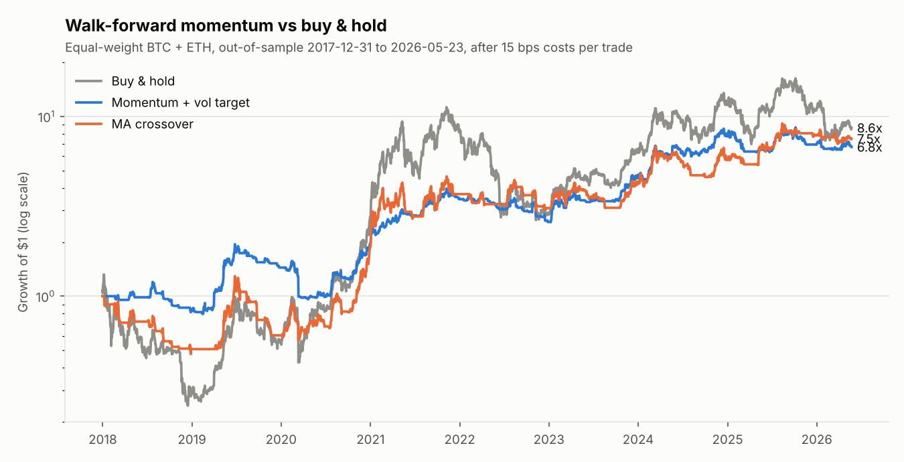
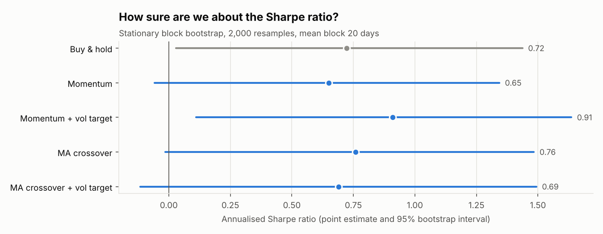
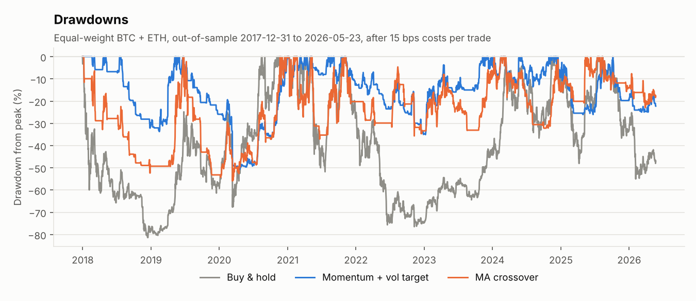

# Crypto Strategy Backtest

[](https://github.com/OWNER/crypto-strategy-backtest/actions/workflows/tests.yml)

Do simple trend-following rules actually beat buying and holding BTC and ETH, once you
remove look-ahead bias, pay realistic trading costs and account for how many variants
you tried? This repo answers that with a walk-forward backtest on 8+ years of daily
data, block-bootstrap confidence intervals and the deflated Sharpe ratio.



## Main findings

Out-of-sample, January 2018 to May 2026, equal-weight BTC + ETH, after 15 bps per trade:

| Strategy | CAGR | Sharpe | Max drawdown | Sharpe vs B&H: bootstrap p | Sharpe with 2x costs |
|---|---|---|---|---|---|
| Buy & hold | 29.3% | 0.72 | -81.4% | - | 0.72 |
| Momentum | 22.1% | 0.65 | -72.8% | 0.65 | 0.52 |
| Momentum + vol target | 25.5% | **0.91** | -50.7% | 0.24 | 0.46 |
| MA crossover | 27.1% | 0.76 | -55.9% | 0.47 | **0.74** |
| MA crossover + vol target | 17.3% | 0.69 | **-42.9%** | 0.57 | 0.66 |

1. **None of the rules beats buy & hold on risk-adjusted return with any confidence.**
   The best paired-bootstrap p-value is 0.24; every 95% interval for the Sharpe
   difference straddles zero. Eight years of daily crypto data is not enough to tell
   a Sharpe of 0.9 from 0.7.
2. **What the rules do reliably is cut drawdowns.** The MA crossover earned 27.1% a year against 29.3%
   for holding, while cutting the worst loss from -81% to -56%. Adding volatility targeting
   brings the worst loss down to between -43% and -51%, mostly at the price of lower returns.
3. **The best-looking result is the most fragile.** Momentum + vol target has the top
   Sharpe (0.91), but it halves to 0.46 with double costs or one extra day of execution
   delay. The plain MA crossover barely moves (0.74 to 0.79). If I had reported only the
   best row, the conclusion would have been wrong.
4. **The "optimal" parameters are unstable.** The walk-forward picked BTC momentum
   lookbacks anywhere from 14 to 270 days from one half-year to the next
   ([full list](results/REPORT.md#parameters-chosen-in-each-fold)), which is a sign
   that the in-sample winner is mostly noise.

Full tables per asset: [`results/REPORT.md`](results/REPORT.md).




## Method

| Step | What is done | Where |
|---|---|---|
| Data | Daily USD reference prices from the free [Coin Metrics community archive](https://github.com/coinmetrics/data), cleaned to a gap-checked daily calendar | `data.py` |
| Signals | Time-series momentum (11 lookbacks, 7-365 days) and moving-average crossover (17 fast/slow pairs), long-only spot, optionally scaled to 40% annual volatility with a 10% no-trade band | `signals.py` |
| Timing | A position decided at the close of day *t* earns the return of day *t+1*. A test recomputes every signal on truncated price histories to prove no future data is used | `backtest.py`, `tests/test_signals.py` |
| Costs | 10 bps fee + 5 bps slippage charged on every unit of turnover, including at fold boundaries | `backtest.py` |
| Walk-forward | Pick the parameters with the best Sharpe on the previous 3 years, trade them unchanged for the next 6 months, roll forward. Only out-of-sample days are reported | `walkforward.py` |
| Uncertainty | Stationary block bootstrap (mean block 20 days, 2,000 resamples) keeps volatility clustering intact. Paired resampling for strategy-vs-benchmark tests | `stats.py` |
| Selection bias | Deflated Sharpe ratio (Bailey & López de Prado, 2014): probability that the Sharpe is above what the best of 58 lucky variants would show | `stats.py` |
| Robustness | Rerun everything with 2x costs and with an extra day of execution delay | `report.py` |

How to read the two significance numbers: the **deflated Sharpe** (in `REPORT.md`) asks
"is this strategy's Sharpe above zero after correcting for the number of variants tried?"
and is mostly above 0.9 because crypto had a strong up-trend. The **bootstrap p-value** asks
the harder question, "is it better than just holding?", and the answer is no.

## Run it

```bash
git clone https://github.com/OWNER/crypto-strategy-backtest.git
cd crypto-strategy-backtest
pip install -e ".[dev]"

pytest                                 # 37 tests, runs offline
python -m cryptobt run                 # full experiment, about 15 s -> results/
python -m cryptobt fetch               # optional: refresh data/ from Coin Metrics
```

Every assumption is a flag, for example:

```bash
python -m cryptobt run --fee-bps 5 --slippage-bps 10 --train-days 730 --test-days 90 --target-vol 0.3
```

## Project layout

```
src/cryptobt/
  data.py          download, clean and load prices
  signals.py       momentum, MA crossover, vol targeting, no-trade band
  backtest.py      vectorised engine with explicit timing and costs
  metrics.py       CAGR, Sharpe, Sortino, drawdown, Calmar
  stats.py         stationary bootstrap, paired test, PSR / deflated Sharpe
  walkforward.py   rolling parameter selection, stitched OOS backtest
  report.py        experiment runner, stress tests, tables
  plots.py         figures
tests/             unit tests (timing, costs, look-ahead, bootstrap, walk-forward)
data/              cleaned BTC / ETH daily prices (Coin Metrics, CC BY-NC 4.0)
results/           generated tables, per-fold parameter choices and figures
```

## Limitations

- Long-only spot with no leverage, no shorting and no funding or borrow costs.
- Daily reference prices, not exchange order books: real fills will differ, which is
  why the delay and cost stress tests are included.
- Two assets and one sample period. Crypto's 2018-2026 path (two -75% bear markets, two
  bull runs) is a single history, and the bootstrap cannot create regimes that never happened.
- The data archive ended on 2026-05-23 when it was fetched; `cryptobt fetch` pulls whatever is newest.

## References

- Moskowitz, Ooi & Pedersen (2012), *Time series momentum*, Journal of Financial Economics.
- Politis & Romano (1994), *The stationary bootstrap*, JASA.
- Bailey & López de Prado (2014), *The deflated Sharpe ratio*, Journal of Portfolio Management.

## License

Code: MIT. Data: © Coin Metrics, [CC BY-NC 4.0](https://creativecommons.org/licenses/by-nc/4.0/).
